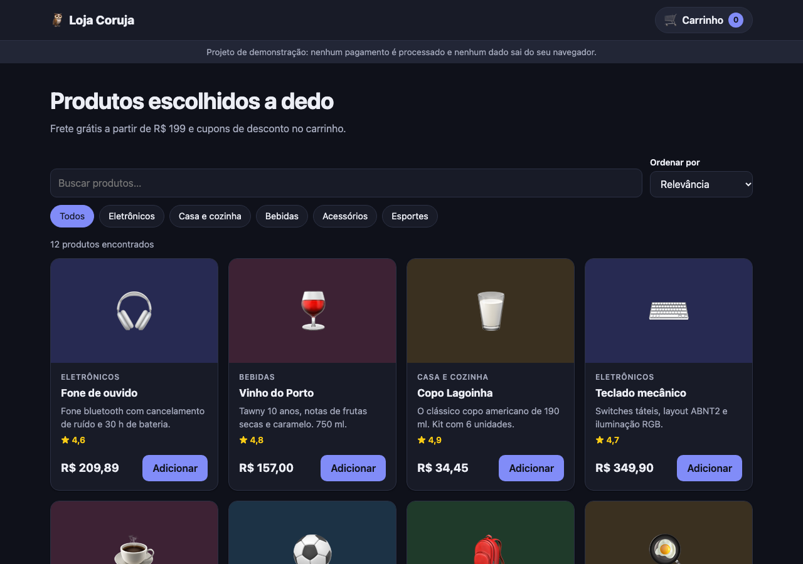

# 🦉 Loja Coruja: carrinho de compras

[](https://github.com/GabrielCoruja/shopping_cart/actions/workflows/ci.yml)
[](https://github.com/GabrielCoruja/shopping_cart/actions/workflows/deploy.yml)


Loja virtual de demonstração com catálogo, busca, filtros, carrinho com cupons e frete grátis, e checkout com validação. Tudo roda no navegador, sem back-end.

**🔗 Acesse:** https://gabrielcoruja.github.io/shopping_cart/



## Funcionalidades

- **Catálogo** com 12 produtos em 5 categorias
- **Busca** por nome ou descrição, **filtro por categoria** e **ordenação** por preço, nome ou avaliação
- **Carrinho** em painel lateral:
  - aumentar, diminuir ou remover itens, respeitando o limite de estoque de cada produto
  - barra de progresso até o **frete grátis** (a partir de R$ 199)
  - **cupons de desconto**: `CORUJA10` (10%), `BEMVINDO20` (R$ 20 a partir de R$ 100) e `FRETEGRATIS`
- **Persistência**: o carrinho fica salvo no `localStorage` e volta quando você reabre a página
- **Checkout** com validação de nome, e-mail, CEP (com máscara), endereço e forma de pagamento
- **Confirmação do pedido** com número, itens e totais
- **Acessibilidade**:
  - navegação por teclado (o carrinho fecha com Esc)
  - rótulos, `aria-live` no contador e foco no primeiro campo com erro
- **Visual responsivo** e **modo escuro** automático, que segue o sistema

> É um projeto de demonstração: nenhum pagamento é processado e nenhum dado sai do navegador.

## Tecnologias

| Área | Ferramentas |
| :-- | :-- |
| Interface | React 19 e CSS próprio (sem framework de UI) |
| Estado | Redux Toolkit (slices, selectors memorizados e ações compartilhadas entre slices) |
| Rotas | React Router (HashRouter, compatível com o GitHub Pages) |
| Linguagem e build | TypeScript (modo `strict`) e Vite |
| Testes | Vitest e Testing Library |
| Qualidade | ESLint (typescript-eslint e regras de hooks) |
| CI/CD | GitHub Actions: lint, tipos, testes e build a cada PR, e deploy automático no GitHub Pages |

## Decisões técnicas

- **Preços em centavos**: todos os valores são inteiros (`priceInCents`), o que evita erros de ponto flutuante como `0.1 + 0.2`. A formatação em reais acontece só na hora de exibir, com `Intl.NumberFormat`.
- **Regras de negócio isoladas** em `src/utils/pricing.ts` (frete e cupons), como funções puras e fáceis de testar.
- **O estado guarda só o essencial**: o carrinho guarda `{ productId, quantity }`, e subtotal, desconto e total são calculados por selectors (`createSelector`).
- **Leitura segura do `localStorage`**: dados corrompidos, produtos que não existem mais ou quantidades acima do estoque são descartados ou ajustados ao carregar.
- **Sem dependências externas em tempo de execução**: os produtos e as "imagens" (emojis) são locais, então o site não quebra se uma API ou imagem de terceiros sair do ar.

## Estrutura

```
src/
├── components/   # Header, filtros, card de produto, carrinho, resumo e cupom
├── pages/        # catálogo, checkout (e validação), pedido confirmado e 404
├── store/        # slices (cart, filters, orders, ui), selectors e persistência
├── data/         # catálogo de produtos e categorias
├── utils/        # formatação de preço e regras de frete e cupons
└── test/         # configuração dos testes
```

## Como executar

**Pré-requisito:** Node.js 22.12 ou superior.

```sh
git clone https://github.com/GabrielCoruja/shopping_cart.git
cd shopping_cart
npm install
npm run dev
```

Abra http://localhost:5173/shopping_cart/.

| Comando | O que faz |
| :-- | :-- |
| `npm run dev` | Servidor de desenvolvimento |
| `npm test` | Roda os testes |
| `npm run coverage` | Testes com relatório de cobertura |
| `npm run lint` | ESLint |
| `npm run typecheck` | Checagem de tipos |
| `npm run build` | Build de produção em `dist/` |

## Histórico

A primeira versão (2020) foi um exercício de Redux com 3 produtos fixos e uma action por produto. Esta versão reescreve o projeto com TypeScript, Redux Toolkit, testes e deploy automático.

## Licença

Distribuído sob a licença MIT. Veja [LICENSE](LICENSE).

---

Feito por [Gabriel Dalseco](https://www.linkedin.com/in/gabrieldalseco/).
